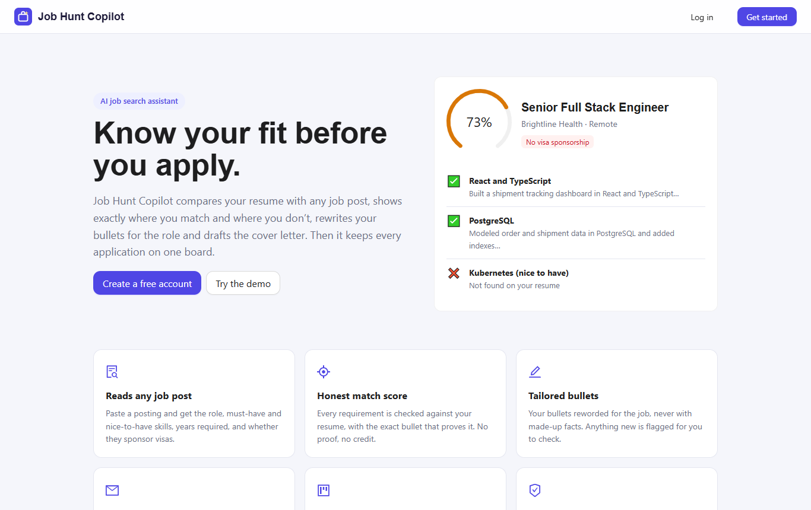
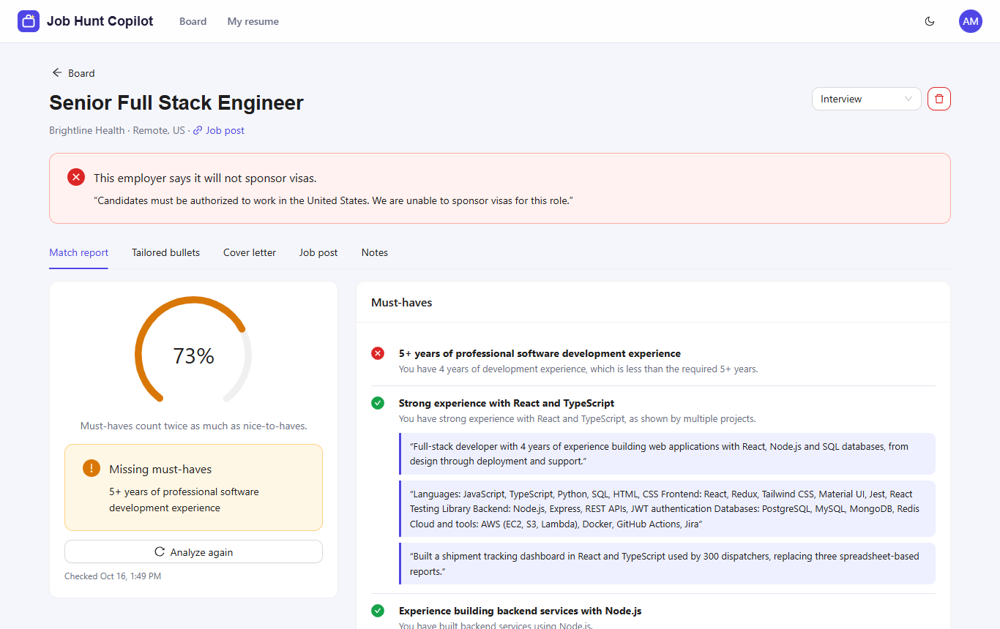
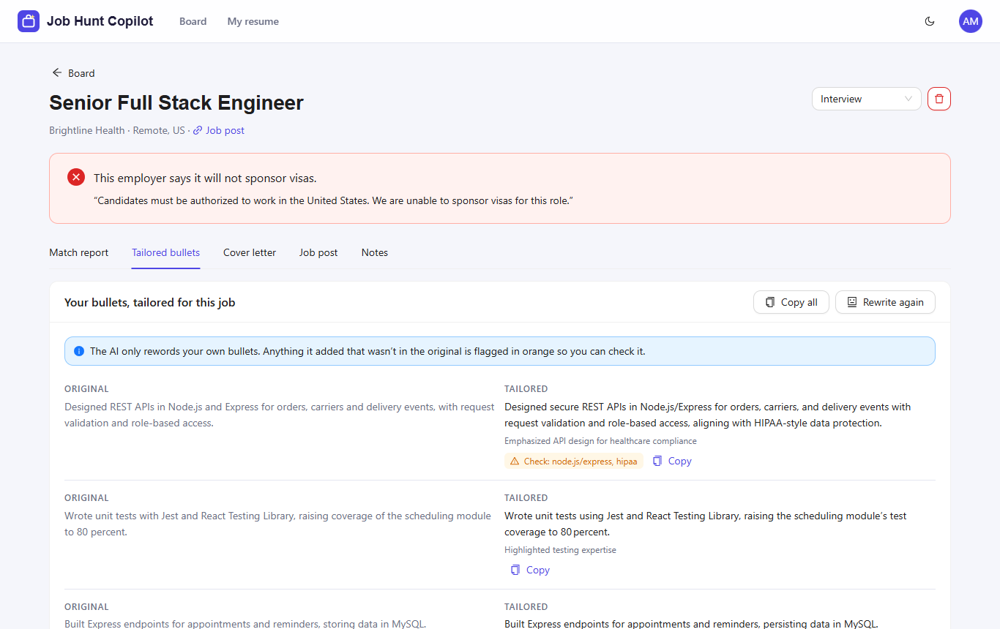
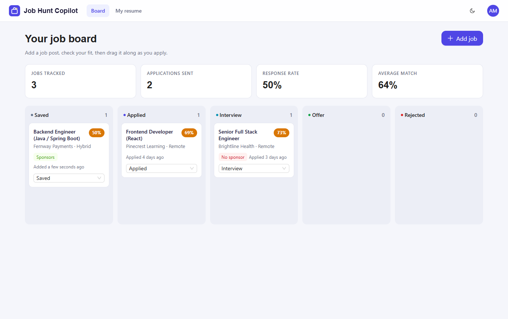
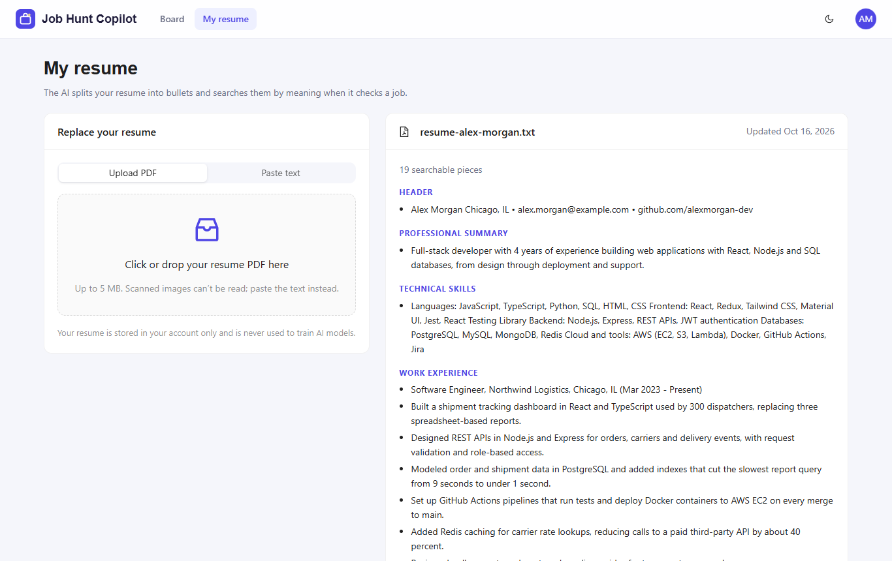
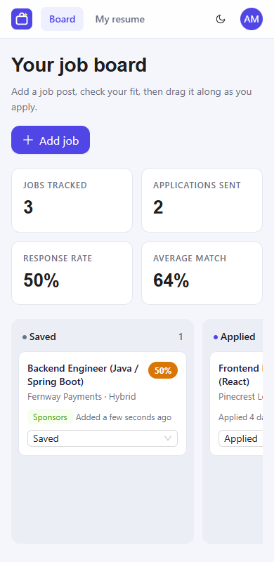

# Job Hunt Copilot


-412991)


An AI job search assistant. Paste a job post and it tells you how well your resume fits, **with the exact resume bullet that proves each point**, rewrites your bullets for the role without inventing anything, drafts a plain cover letter, and keeps every application on a drag-and-drop board.

**Live demo: [job-hunt-copilot-web.onrender.com](https://job-hunt-copilot-web.onrender.com)**. Click **Log in**, then **Use the demo account**. It runs on Render's free plan, so if nobody has visited in a while, an opening screen shows while the server wakes up (up to a minute).



## What it does

- **Reads any job post:** role, company, location, years required, must-have and nice-to-have skills, and **whether the employer sponsors visas** (with the exact sentence quoted).
- **Match report:** every requirement marked met, partly met or missing, each backed by the resume bullet that proves it. The score is calculated in code: must-haves count twice as much as nice-to-haves.
- **Tailored bullets:** your most relevant bullets reworded toward the job. Any number, tool or name the rewrite added that wasn't in the original is **flagged for you to check**.
- **Cover letter:** a short, plain draft built only from your real experience; edit, save and copy.
- **Application board:** Saved → Applied → Interview → Offer / Rejected, with drag and drop, response rate and average match.
- **Resume upload:** PDF or pasted text, split into sections and bullets you can see.

| Match report | Tailored bullets |
| --- | --- |
|  |  |

| Board | Resume | Mobile |
| --- | --- | --- |
|  |  |  |

## How the AI works

```
Resume PDF ──► text ──► bullets/sections ──► embeddings (all-MiniLM-L6-v2, on the server)
                                                    │
Job post ──► gpt-oss-20b ──► requirements, sponsorship    │
                                   │                    ▼
                                   └──► hybrid retrieval: top-3 by meaning + keyword hits
                                                    │
                                   gpt-oss-120b judges each requirement using ONLY those bullets
                                                    │
                                   code: validates evidence, computes score, flags new terms
```

Design choices worth calling out:

1. **Retrieval-augmented generation (RAG).** For each requirement, only the 3 or so most relevant bullets are sent to the model, not the whole resume. Answers stay grounded in real text, and requests stay small enough for Groq's free tier (8,000 tokens a minute).
2. **Hybrid search.** Embeddings find bullets with the same meaning ("built REST services" ≈ "API development"), but they missed a skill buried in a long skills line ("…MySQL, PostgreSQL, MongoDB…"). Adding exact keyword matches fixed that: on a real resume, the score for a sample job went from 67% to a correct 80%.
3. **The model judges; code does the math.** Scores, evidence checks and the "new terms" warning are computed in JavaScript. Evidence that points at a bullet that doesn't exist is dropped, and a "met" with no valid evidence is downgraded to "partial".
4. **Small model for extraction, big model for judgement.** gpt-oss-20b reads job posts; gpt-oss-120b judges matches and writes. Lower reasoning effort on simple steps cut hidden "thinking" tokens by about 65%.
5. **Strict JSON Schema output** for every structured answer, with automatic retries on rate limits and on the occasional invalid JSON.
6. **Open models only.** gpt-oss is open-weight (Apache 2.0) and the embedding model runs inside the Node.js server, so no resume text is sent to an embeddings API. Any OpenAI-compatible endpoint works, including a local Ollama server.

## Tech stack

| Part | Stack |
| --- | --- |
| Front end | React 19, Vite, Ant Design 6, React Query, React Router |
| Back end | Node.js, Express 5, MongoDB + Mongoose, Zod, JWT, bcrypt, Helmet, rate limiting, Multer |
| AI | gpt-oss-120b / gpt-oss-20b via Groq (OpenAI-compatible API), Transformers.js embeddings, unpdf |
| Hosting | Render: a static site for the web app (never sleeps) and a web service for the API, from one Blueprint (`render.yaml`) |
| Tests | Node test runner, Supertest, mongodb-memory-server, a fake LLM (39 tests, including edge cases) |

## Run it

You need Node.js 20+ and a free [Groq API key](https://console.groq.com) (no credit card).

```bash
npm install
npm install --prefix client
cp .env.example .env          # then add GROQ_API_KEY and a JWT_SECRET
npm run dev:all               # API on :8080 with demo data, web app on :5173
```

Open http://localhost:5173 and click **Use the demo account** (demo@jobcopilot.app / demo12345). The demo runs on an in-memory database with a sample resume and three analyzed jobs. For real use, set `MONGO_URL` and run `npm run dev` plus `npm run client`.

The embedding model (about 23 MB) downloads on first use. On a slow or unreliable connection, run `bash scripts/download-model.sh` first.

## Tests

```bash
npm test
```

The tests use a fake LLM and a tiny word-hashing embedder, so they run offline in seconds. They cover authentication, resume parsing, job reading, scoring, the evidence checks, the invented-facts flag, sending only retrieved bullets to the model, and making sure users can never see each other's data.

## Project structure

```
server/
  services/llm.js            OpenAI-compatible client: JSON Schema output, retries, rate limits
  services/embeddings.js     Local sentence embeddings and similarity search
  services/resumeParser.js   PDF to text, then sections and bullets
  services/copilot.js        Job reading, hybrid retrieval, match scoring, tailoring, cover letters
  controllers/               Auth, resume, jobs
client/src/pages/            Landing, Board, JobDetail, ResumePage, AuthPages
scripts/demo.js              Demo server with sample data (no database needed)
scripts/build-demo-data.js   Regenerates the demo data with the real AI
tests/                       API and AI-logic tests
docs/samples/                Sample resume (fictional) and job posts
```

## Privacy

Resumes are stored only in your account and are never used for training. Uploaded PDFs are read in memory and not saved to disk. Embeddings are computed on the server, and only the few bullets relevant to a requirement are sent to the language model.

## Deploy on Render

`render.yaml` is a Render Blueprint with two services:

- **job-hunt-copilot-web**: the React app as a static site. Free static sites never sleep, so it opens instantly and shows an opening animation while it wakes the API.
- **job-hunt-copilot**: the Node.js API. It sleeps after 15 idle minutes on the free plan. With `SEED_DEMO=true` it recreates the demo account each time it starts.

In Render, choose **New → Blueprint**, pick this repo, and fill in `MONGO_URL` (a MongoDB Atlas connection string; allow access from anywhere in Atlas **Network Access**) and `GROQ_API_KEY`. Everything else is set automatically.
